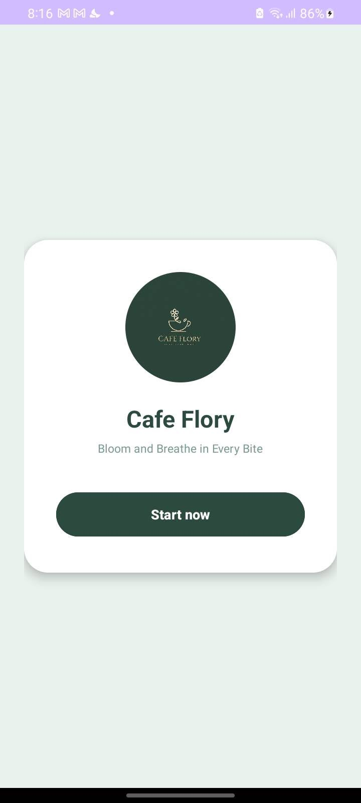
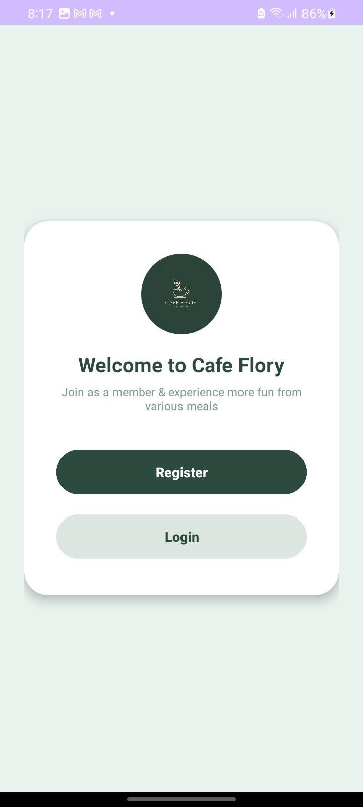
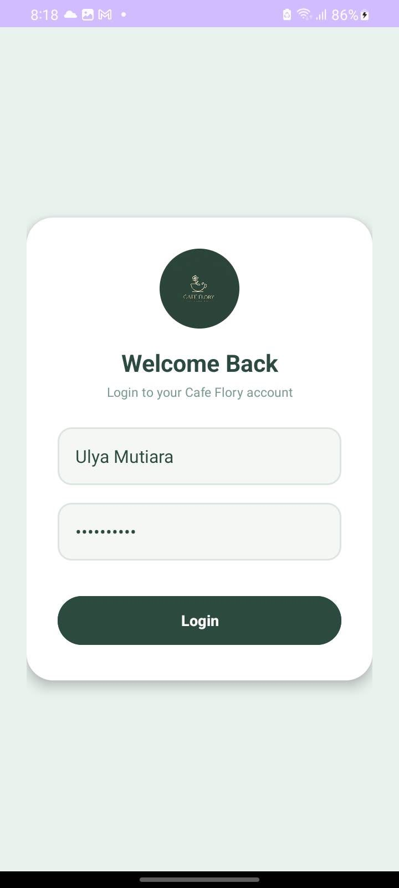
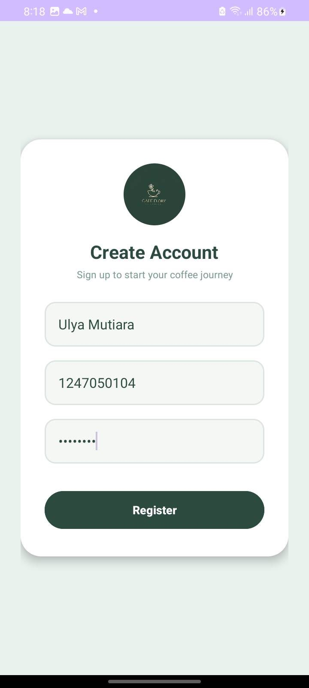
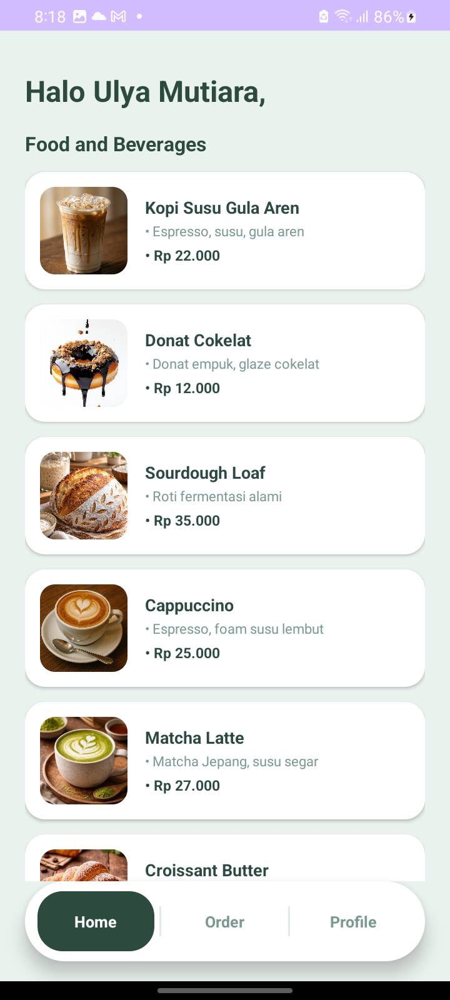
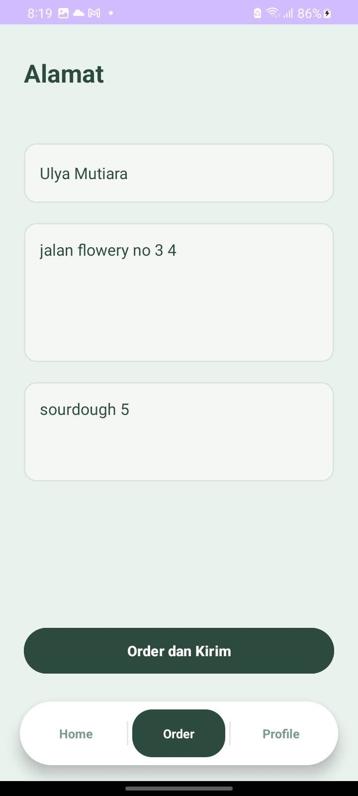
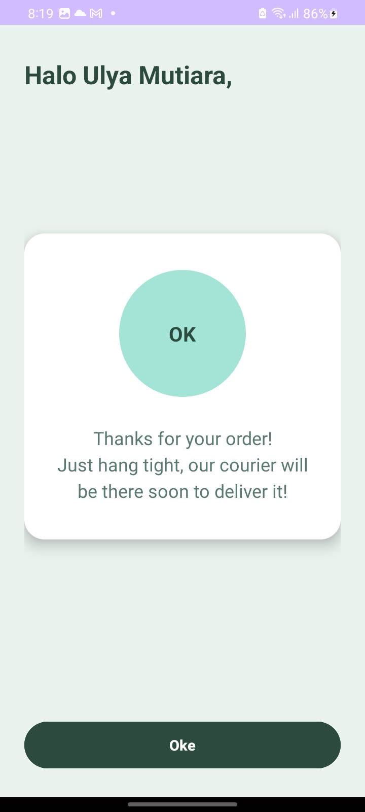
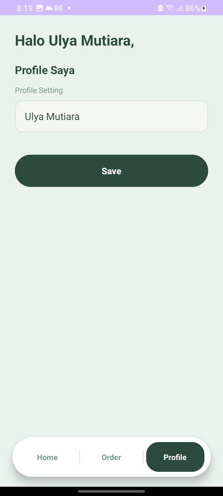

# 🌿 Cafe Flory - Mobile Cafetaria App

**Cafe Flory** ("*Bloom and Breathe in Every Bite*") adalah aplikasi katalog menu dan pemesanan makanan/minuman berbasis Android yang dibangun menggunakan **Kotlin**. Aplikasi ini dirancang dengan antarmuka yang bersih, modern, dan mengusung palet warna hijau alami (*Forest Green*) yang estetis.

---

## 📱 Alur & Tampilan Antarmuka (UI Screenshots)

Berikut adalah dokumentasi antarmuka aplikasi **Cafe Flory** dari tahap awal hingga alur pemesanan selesai:

### 1. Splash Screen & Welcome Screen
| Splash Screen | Welcome Screen |
| :---: | :---: |
|  |  |
| *Layar pembuka dengan logo dan slogan khas Cafe Flory.* | *Pintu masuk utama untuk memilih Login atau Register.* |

---

### 2. Autentikasi Pengguna
| Login Screen | Register Screen |
| :---: | :---: |
|  |  |
| *Form masuk menggunakan nama pengguna dan kata sandi.* | *Form pendaftaran akun anggota baru Cafe Flory.* |

---

### 3. Halaman Utama & Pemesanan
| Home Screen (Katalog) | Order Screen |
| :---: | :---: |
|  |  |
| *Salam personal pengguna & daftar menu kopi, pastry, serta makanan.* | *Form pengisian alamat pengiriman dan catatan pesanan.* |

---

### 4. Konfirmasi & Profil
| Order Success | Profile Screen |
| :---: | :---: |
|  |  |
| *Notifikasi konfirmasi pengiriman pesanan oleh kurir.* | *Pengaturan data profil dan nama akun pengguna.* |

---

## ✨ Fitur Utama

* **Autentikasi Pengguna:** Pendaftaran akun baru dan sistem login masuk.
* **Katalog Menu Dinamis:** Daftar item makanan & minuman lengkap dengan thumbnail gambar, deskripsi/komposisi, dan harga.
* **Bottom Navigation Bar:** Navigasi intuitif antar halaman utama (*Home*, *Order*, *Profile*).
* **Form Pemesanan & Alamat:** Input lokasi alamat pengiriman dan detail daftar pesanan secara langsung.
* **Manajemen Profil:** Pengeditan nama pengguna yang secara otomatis memperbarui salam personal (*Halo [Nama User]*) di seluruh layar aplikasi.
* **UI/UX Consistent Aesthetic:** Tampilan berbasis *CardView* modern dengan sudut melengkung dan tema warna *Pastel Mint & Forest Green*.

---

## 🛠️ Teknologi & Modul

* **Bahasa Pemrograman:** Kotlin
* **IDE:** Android Studio
* **UI Components:** XML Layouts, Material Design 3, Fragment Navigation, CardView, BottomNavigationView, Custom Drawables.
* **Minimum SDK:** Android 7.0 (API Level 24)

---

## 📁 Struktur Project

```text
lat.pam.cafetaria/
├── HomeActivity.kt             # Container utama dengan Bottom Navigation Bar
├── HomeFragment.kt             # Fragment untuk menampilkan daftar katalog menu
├── OrderFragment.kt            # Fragment form alamat dan pemesanan
├── ProfileFragment.kt          # Fragment pengaturan profil pengguna
├── LoginActivity.kt            # Activity autentikasi masuk
├── RegisterActivity.kt         # Activity pendaftaran akun baru
├── OrderSuccessActivity.kt     # Activity dialog konfirmasi pesanan sukses
└── res/
    ├── drawable/               # Asset gambar menu & ikon
    └── layout/                 # File XML antarmuka
```

---

## 🚀 Cara Menjalankan Project

1. *Clone* atau unduh repository project ini.
2. Simpan gambar screenshot UI kamu di dalam folder `screenshots/` dengan nama yang sesuai (`01_splash.png`, `02_welcome.png`, dst.).
3. Buka folder project di **Android Studio**.
4. Jalankan **Sync Project with Gradle Files**.
5. Pilih Emulator (AVD) atau perangkat fisik Android.
6. Klik tombol **Run 'app'** (`Shift + F10`).

---

*Dibuat oleh Ulya Mutiara NF — Project Pemrograman Aplikasi Mobile (PAM)*